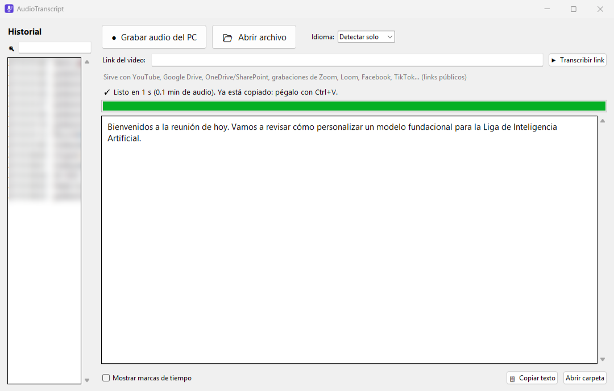
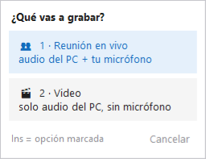

<p align="center">
  
</p>

<h1 align="center">AudioTranscript</h1>

<p align="center">
  <b>Graba y transcribe reuniones, videos y links de YouTube, gratis y en tu propia PC.</b><br>
  Sin límites de uso, sin suscripciones y sin que tu audio salga de tu computadora.
</p>

---

## ¿Qué es?

AudioTranscript convierte en texto cualquier cosa que suene en tu computadora: una reunión de Zoom, Meet o Teams, una clase grabada, un video de YouTube o un archivo de audio. El texto queda **copiado al portapapeles** (lo pegas con `Ctrl+V`) y **guardado en un historial** que puedes buscar después.

Usa **[Whisper](https://github.com/openai/whisper)** (`large-v3-turbo`), el modelo de voz a texto de OpenAI, ejecutado localmente con [faster-whisper](https://github.com/SYSTRAN/faster-whisper). Con una tarjeta NVIDIA, una reunión de **2 horas** se transcribe en unos **2 minutos**.

| | AudioTranscript | Servicios en la nube |
|---|---|---|
| Costo | **Gratis** | Plan de pago o límite semanal |
| Límite de uso | **Ninguno** | Minutos o palabras por mes |
| Privacidad | **Tu audio nunca sale de tu PC** | Se sube a sus servidores |
| Internet | Solo para bajar links | Siempre |

## Lo que puedes hacer

### 🎙️ Grabar con la tecla `Ins`, sin abrir nada
Presiona **`Ins`** (arriba a la derecha, junto a `F12`) desde cualquier programa y elige qué grabar:

<p align="center"></p>

- **Reunión en vivo**: audio de la PC **+ tu micrófono** (Meet, Zoom, Teams…).
- **Video**: **solo** el audio de la PC (YouTube, cursos, videos grabados).

Mientras graba solo se ve un **puntito gris** junto al reloj de Windows: nada de contadores ni luces rojas. Si le pasas el mouse por encima aparecen el tiempo y los controles (puedes prender o apagar el micrófono a mitad de la grabación):

<p align="center"></p>

Presiona **`Ins`** otra vez (o *Detener*) y en segundos el texto queda copiado y guardado:

<p align="center"></p>

> **Discreto al presentar:** el menú y el puntito **no aparecen cuando compartes pantalla** ni en grabaciones de pantalla. Tú los ves; los demás no. Tampoco te quitan el foco del programa en el que estás escribiendo.

### 🔗 Pegar un link y transcribirlo sin reproducirlo
Pega el link en la ventana de AudioTranscript y listo: baja solo el audio y lo transcribe. Funciona con links **públicos** de:

YouTube · Google Drive · grabaciones compartidas de Zoom · Loom · Facebook · TikTok · Instagram · X/Twitter · [y más de 1000 sitios](https://github.com/yt-dlp/yt-dlp/blob/master/supportedsites.md)

Si una grabación de Zoom pide código de acceso, la app te lo pregunta. Para OneDrive/SharePoint intenta la descarga directa; si el link no lo permite, te dice cómo seguir.

### 📂 Abrir un archivo
MP4, MP3, M4A, WAV, WEBM, MKV, MOV y más. También puedes arrastrar un archivo encima del ícono.

### 🔎 Historial con buscador
Todo lo que transcribes queda en el panel izquierdo. El buscador encuentra **cualquier palabra que se haya dicho**, no solo el nombre del archivo. Cada transcripción se guarda en `Documentos\Transcripciones` en dos versiones: texto limpio y con marcas de tiempo (`[0:05:12] …`).

### 🎵 Música y canciones también
Si detecta que casi no hay voz hablada (por ejemplo, canto sobre música), vuelve a transcribir sin el filtro de voz para no perder la letra.

## Instalación

### Requisitos
- **Windows 10 u 11**
- **[Python 3.10 o más nuevo](https://www.python.org/downloads/)** — al instalarlo marca la casilla **"Add python.exe to PATH"**
- Unos **3 GB libres** (librerías + modelo)
- **Recomendado:** tarjeta gráfica **NVIDIA**. Sin ella también funciona, usando el procesador, pero más lento.

### Pasos
1. **[Descarga el ZIP](https://github.com/cesar-stich/AudioTranscript/archive/refs/heads/main.zip)** (o botón verde **Code → Download ZIP**) y descomprímelo.
2. Haz **doble clic en `instalar.bat`**.
   El instalador baja las librerías, detecta tu tarjeta NVIDIA, descarga el modelo Whisper (~1.6 GB, una sola vez) y crea el ícono en el escritorio y en el menú Inicio.
3. Al final te pregunta si quieres que la tecla **`Ins`** funcione siempre desde que prendes la PC. Responde **S** si quieres.

¡Listo! Abre **AudioTranscript** desde el escritorio, o presiona **`Ins`**.

> Si Windows muestra *"Windows protegió su PC"* al abrir `instalar.bat`, haz clic en **Más información → Ejecutar de todas formas**. Pasa con cualquier archivo descargado de internet que no está firmado.

## Preguntas frecuentes

<details>
<summary><b>¿Gasta tokens, créditos o tiene algún límite?</b></summary>

No. La transcripción la hace Whisper **dentro de tu PC**: no usa ninguna API ni servicio de pago. Puedes transcribir todas las horas que quieras. Lo único que te limita es el espacio en disco: puedes borrar los audios viejos de `Documentos\Transcripciones\audios` cuando quieras, los textos casi no ocupan.
</details>

<details>
<summary><b>¿Es lo mismo que Wispr Flow?</b></summary>

No. Wispr Flow es una app de dictado en la nube con plan de pago. AudioTranscript usa **Whisper** (el modelo abierto de OpenAI, parecido solo en el nombre) y está pensado para **transcribir reuniones, videos y links**, no para dictar.
</details>

<details>
<summary><b>¿Graba mi micrófono sin que me dé cuenta?</b></summary>

No. El micrófono solo se abre si eliges **Reunión en vivo** o lo prendes tú desde los controles. En modo **Video** solo se graba lo que suena en la PC.
</details>

<details>
<summary><b>La tecla Ins ya no hace lo que hacía antes</b></summary>

Mientras AudioTranscript esté activo, `Ins` es el botón de grabar en todos los programas (su función original era el modo "sobrescribir" de Word). Si quieres otra tecla, cambia `ATAJO` al inicio de `agente.pyw` en la carpeta de instalación.
</details>

<details>
<summary><b>Un link de YouTube dejó de funcionar</b></summary>

YouTube cambia seguido. Actualiza la herramienta que baja los videos abriendo una terminal y ejecutando:

```
python -m pip install -U yt-dlp
```
</details>

<details>
<summary><b>Un link pide iniciar sesión (Teams, Zoom Events, videos privados)</b></summary>

AudioTranscript solo baja links **públicos**. Para lo demás, reprodúcelo y graba con **`Ins` → Video**.
</details>

<details>
<summary><b>¿Cómo lo desinstalo?</b></summary>

Borra la carpeta `%LOCALAPPDATA%\Programs\AudioTranscript`, el ícono del escritorio y del menú Inicio, y (si lo activaste) el acceso `AudioTranscript (tecla Ins)` de la carpeta de inicio (`Win + R` → `shell:startup`). Tus transcripciones siguen en `Documentos\Transcripciones`.
</details>

## Para desarrolladores

| Archivo | Qué hace |
|---|---|
| `AudioTranscript.pyw` | Ventana principal: archivos, links, historial y buscador |
| `agente.pyw` | Proceso en segundo plano: tecla `Ins`, menú y puntito flotante |
| `nucleo.py` | Lo común: grabación (audio de la PC por WASAPI loopback + micrófono, alineados y mezclados) y transcripción |
| `transcribir.py` | Versión por línea de comandos: `python transcribir.py grabar` o `python transcribir.py archivo.mp4` |
| `instalar.py` | Instalador que llama `instalar.bat` |

Construido con [faster-whisper](https://github.com/SYSTRAN/faster-whisper), [yt-dlp](https://github.com/yt-dlp/yt-dlp), [PyAudioWPatch](https://github.com/s0d3s/PyAudioWPatch) y [keyboard](https://github.com/boppreh/keyboard).

## Licencia

[MIT](LICENSE) © cesar-stich
